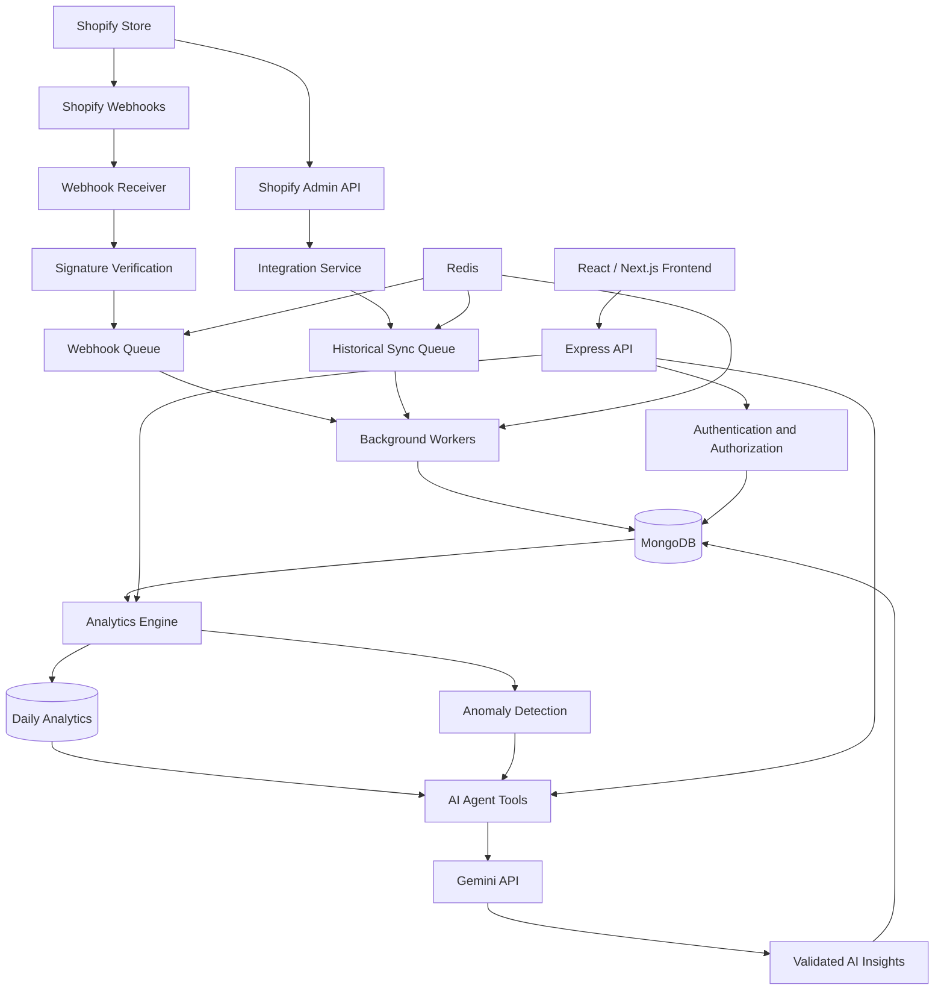

# StorePilot AI 🚀
### AI-Powered Shopify Business Intelligence & Decision Agent

StorePilot AI is an intelligent business analytics platform designed to help Shopify merchants understand their store performance, identify profitability issues, detect business risks, and make better decisions using data-driven insights and AI-powered investigations.

Unlike traditional dashboards that simply display charts and metrics, StorePilot AI combines deterministic analytics, historical business data, anomaly detection, and an AI agent to explain **what happened, why it may have happened, and what the merchant should consider doing next.**

The platform connects to authorized Shopify stores, processes commerce data, calculates business metrics, and generates actionable daily briefings, product profitability reports, inventory intelligence, and evidence-based recommendations.

> **Project Status:** In Development  
> **Project Type:** AI-Powered SaaS / Business Intelligence  
> **Primary Platform:** Shopify  
> **Architecture:** Multi-tenant SaaS  
> **Frontend:** React / Next.js, TypeScript, Tailwind CSS  
> **Backend:** Node.js, Express.js, TypeScript  
> **Database:** MongoDB  
> **AI Provider:** Google Gemini API

---

## 📌 Table of Contents

- [Overview](#-overview)
- [Problem Statement](#-problem-statement)
- [Our Solution](#-our-solution)
- [Target Users](#-target-users)
- [Core Features](#-core-features)
- [Application Modules](#-application-modules)
- [AI Agent Architecture](#-ai-agent-architecture)
- [Analytics and Financial Calculations](#-analytics-and-financial-calculations)
- [System Architecture](#-system-architecture)
- [Technology Stack](#-technology-stack)
- [Database Design](#-database-design)
- [Project Structure](#-project-structure)
- [Getting Started](#-getting-started)
- [Environment Variables](#-environment-variables)
- [Shopify Integration](#-shopify-integration)
- [AI Integration](#-ai-integration)
- [Data Processing Pipeline](#-data-processing-pipeline)
- [Security](#-security)
- [Testing](#-testing)
- [Deployment](#-deployment)
- [Development Roadmap](#-development-roadmap)
- [Known Limitations](#-known-limitations)
- [Contributing](#-contributing)
- [License](#-license)

---

## 🎯 Overview

Shopify merchants generate large amounts of business data every day, including orders, products, discounts, refunds, inventory movements, and customer activity. Understanding this data and turning it into meaningful decisions can be time-consuming.

StorePilot AI aims to simplify this process by providing one intelligent workspace for store performance monitoring, profitability analysis, operational risk detection, and business decision support.

The application is designed around five fundamental questions:

1. **What happened?** — Understand sales, profit, order volume, product performance, and inventory changes.
2. **Why did it happen?** — Investigate unusual changes using available historical data and supporting evidence.
3. **What needs attention?** — Identify loss-making products, rising refunds, stockout risks, and other business issues.
4. **What should happen next?** — Receive prioritized, practical recommendations with transparent reasoning.
5. **How do we measure the result?** — Track performance over time and compare actual results with previous periods.

### Product Vision

Build a reliable AI business intelligence agent that transforms raw Shopify data into understandable, traceable, and actionable business intelligence.

---

## ❗ Problem Statement

Shopify merchants frequently encounter the following challenges:

- Sales dashboards display revenue but do not always make profitability easy to understand.
- Product costs may be missing or difficult to maintain, making profit calculations unreliable.
- Manual analysis of sales, discounts, refunds, and order trends consumes valuable time.
- Inventory shortages and slow-moving products may go unnoticed.
- Sudden changes in sales, order volume, and refund rates can be difficult to investigate.
- Merchants may struggle to identify which products deserve attention and which actions have the greatest potential impact.
- AI-generated answers can be misleading when they are not grounded in verified business data.

StorePilot AI addresses these problems through transparent analytics, automated monitoring, and an AI agent that works with calculated metrics and traceable evidence.

---

## 💡 Our Solution

StorePilot AI connects authorized Shopify store data to an analytics and intelligence engine.

The platform processes business records, calculates financial metrics, detects important changes, and makes structured evidence available to the AI agent.

The agent then explains findings in natural language, investigates merchant questions using approved tools, and generates prioritized recommendations.

The platform follows an important principle:

**The analytics engine calculates the numbers. The AI agent interprets the evidence. The merchant remains in control of business decisions.**

---

## 👥 Target Users

### Shopify Store Owners
Merchants who want to understand their business performance without manually analyzing multiple reports.

### E-commerce Entrepreneurs
Business owners looking for product profitability insights, inventory risk detection, and growth opportunities.

### E-commerce Agencies
Agencies managing multiple authorized Shopify stores that need a consistent way to review performance and identify business issues.

### Growing Online Businesses
Businesses that need more useful intelligence than a traditional dashboard can provide.

---

## ✨ Core Features

### 1. Business Overview Dashboard

A centralized dashboard showing the most important business metrics.

Features:

- Net sales and sales growth.
- Gross profit and gross margin when cost data is available.
- Total orders and average order value.
- Sales and profitability trends.
- Best-performing products.
- Products with low margins or potential losses.
- Inventory warnings.
- Recent business activity.
- High-priority AI insights.

Users can filter results by date range and compare performance with an appropriate previous period.

### 2. AI Daily Business Briefing

An automatically generated summary of important store activity.

The briefing can include:

- What went well.
- What needs attention.
- Significant sales or profit changes.
- Products requiring investigation.
- Inventory risks.
- Emerging business opportunities.
- Recommended next steps.

Each important finding should include supporting metrics, the reporting period, and links to the relevant analytics or records.

### 3. Sales Analytics

Understand sales performance across different reporting periods.

Features:

- Gross sales and net sales.
- Discounts and refunds.
- Order volume.
- Average order value.
- Daily, weekly, and monthly trends.
- Comparison with previous periods.
- Sales breakdowns by product and other available dimensions.

Financial definitions and the treatment of taxes, shipping, discounts, and refunds must be explicit and consistent.

### 4. Product Profitability Intelligence

Identify products that generate revenue and products that may be reducing profitability.

Features:

- Product and variant performance.
- Units sold.
- Net sales.
- Cost of goods sold.
- Gross profit.
- Gross margin.
- Refund and discount trends.
- High-revenue, low-margin products.
- Potentially loss-making products.
- Product-level historical comparisons.

Profitability results must clearly indicate when product costs or other necessary financial inputs are missing.

### 5. Inventory Intelligence

Monitor inventory and identify products requiring attention.

Features:

- Available inventory.
- Committed and incoming quantities when available.
- Low-stock and out-of-stock alerts.
- Historical inventory snapshots.
- Sales velocity.
- Estimated days of stock remaining.
- Potential stockout risks.
- Slow-moving inventory indicators.
- Suggested inventory review priorities.

Forecasts must show their assumptions and uncertainty. The platform must not present an estimated stockout date as a certainty.

### 6. Order and Refund Analytics

Analyze order activity and investigate operational problems.

Features:

- Order-level financial information.
- Order status and fulfillment status.
- Discounts and refunds.
- Cancellation trends.
- Unusual order-value patterns.
- Product return and refund analysis.
- Searchable order records.
- Links between orders, products, and relevant insights.

Access to customer and order information must follow the authorized Shopify permissions and applicable privacy requirements.

### 7. Customer Insights

Understand customer behavior through appropriate aggregate metrics.

Potential metrics include:

- New and returning customers.
- Repeat purchase rate.
- Purchase frequency.
- Customer cohort trends.
- Average customer order value.
- Retention patterns.

These metrics should only be displayed when the underlying data and definitions support reliable calculations.

### 8. Marketing Intelligence

Analyze marketing performance when the required data sources are connected.

Potential features:

- Marketing-attributed sales.
- Campaign performance.
- Channel comparisons.
- Advertising expenditure from connected sources.
- Return on ad spend (ROAS), when sufficient data is available.

Shopify-attributed sales must not be treated as actual advertising expenditure. Marketing analytics should explicitly identify missing sources and attribution limitations.

### 9. AI Business Investigation Workspace

A conversational interface that lets merchants investigate business questions.

Example questions:

- Why did my profit decrease this week?
- Which products have the lowest margins?
- Why are refunds increasing?
- Which products may run out of stock soon?
- What changed compared with the previous month?
- Which business issues should I investigate first?

The agent should return:

- A concise conclusion.
- Verified supporting metrics.
- Relevant products, orders, or reporting periods.
- Potential contributing factors.
- A distinction between evidence and hypotheses.
- Confidence and uncertainty information.
- Practical next steps.

### 10. Recommendations and Action Center

A centralized workspace for managing AI-generated recommendations.

Each recommendation can include:

- Business problem.
- Supporting evidence.
- Priority and urgency.
- Expected impact when reasonably estimable.
- Confidence level.
- Estimated effort.
- Suggested next step.
- Recommendation status.

Suggested statuses include New, Reviewed, In Progress, Completed, Dismissed, and Needs Review.

The initial product is recommendation-first. Business-changing operations must require appropriate authorization and explicit approval unless a separately designed, tested, and authorized automation feature is implemented.

### 11. Anomaly Detection

Identify unusual changes in business metrics.

Examples:

- Unexpected sales declines.
- Sudden increases in refunds.
- Significant order-volume changes.
- Product profitability deterioration.
- Inventory shortages.
- Unusual changes in discounts.

Each anomaly should show its observed value, historical baseline, deviation, affected period, and available evidence.

Correlation must not be presented as proven causation.

### 12. Reports and Exports

Generate business reports for different reporting periods.

Potential reports include:

- Daily business briefing.
- Weekly performance summary.
- Monthly business review.
- Product profitability report.
- Inventory risk report.
- Anomaly investigation summary.

CSV and PDF exports can be implemented according to the project's reporting requirements.

### 13. Integrations and Data Health

Monitor the reliability of connected data sources.

Features:

- Shopify connection status.
- Granted permission scopes.
- Last successful synchronization.
- Webhook processing status.
- Historical import progress.
- Missing or incomplete business data.
- Data freshness indicators.
- Retry and recovery information.

The application must never expose API credentials or access tokens in ordinary logs or frontend responses.

### 14. Multi-Tenant Organization Support

Prepare the platform for multiple merchants and agencies.

Features:

- User accounts.
- Organizations.
- Multiple connected stores.
- Organization memberships.
- Role-based access.
- Store-level access restrictions.
- Organization-specific preferences.

All tenant-owned data must be scoped and authorized on the backend.

---

## 🧠 AI Agent Architecture

StorePilot AI is designed as a tool-using business intelligence agent rather than a chatbot that answers questions from general knowledge alone.

### Agent Workflow

1. Receive a user question or a scheduled analysis request.
2. Identify the store, reporting period, and relevant business metrics.
3. Select the appropriate approved analytics tools.
4. Retrieve calculated metrics and relevant records.
5. Compare current results with historical baselines.
6. Identify supported findings and plausible hypotheses.
7. Generate a structured explanation using Gemini.
8. Validate the output and preserve evidence references.
9. Save the investigation or insight.
10. Present findings and recommendations to the merchant.

### Example

**Merchant question:** Why did profit decrease this week?

**Analytics tools:**

- Retrieve net sales and gross profit for the current period.
- Compare results with the previous period.
- Identify products with declining margins.
- Review available discounts and refunds.
- Check product cost completeness.

**Agent response structure:**

- Summary of the profit change.
- Verified metric comparisons.
- Contributing factors supported by available data.
- Additional hypotheses that need verification.
- Suggested actions.
- Links to relevant product and analytics records.

### AI Reliability Principles

- Financial calculations must be performed by deterministic backend logic.
- Gemini must not invent metrics, products, orders, or historical values.
- Important conclusions must reference supporting data.
- Missing data must be disclosed.
- Hypotheses must be distinguished from verified findings.
- Tool execution must be validated and authorized server-side.
- AI-generated output must be treated as untrusted input.
- External actions must not execute solely because the model suggested them.

Gemini function calling or structured tool use can support the agent. A workflow framework such as LangGraph may be introduced if the complexity of multi-step investigations justifies it.

---

## 📊 Analytics and Financial Calculations

Financial definitions must be documented, tested, and applied consistently across the dashboard, reports, and AI agent.

### Gross Sales

A defined measure of product sales before specified deductions. The exact treatment of product adjustments and Shopify reporting conventions must be documented.

### Net Sales

A practical starting definition is:

`Net Sales = Gross Sales - Discounts - Returns`

The implementation must establish whether gross sales includes cancelled orders, refunded amounts, or other adjustments, and avoid subtracting the same amount twice. Reconciliation with Shopify reporting is required.

### Cost of Goods Sold

A practical calculation is:

`COGS = Sum of Eligible Units Sold × Applicable Unit Cost`

The implementation must define how refunds, returned units, missing costs, and historical cost changes are handled.

### Gross Profit

`Gross Profit = Net Sales - COGS`

Gross profit must be unavailable or explicitly incomplete when necessary cost information is missing.

### Gross Margin

`Gross Margin (%) = (Gross Profit / Net Sales) × 100`

When net sales are zero or the metric is otherwise undefined, the system must not display a misleading percentage.

### Average Order Value

`AOV = Eligible Net Sales / Eligible Order Count`

The application must document how cancelled orders, test orders, and fully refunded orders are treated.

### Inventory Days Remaining

`Estimated Days Remaining = Available Inventory / Average Daily Unit Demand`

This estimate requires sufficient historical demand data and a clearly defined inventory quantity. Zero demand, missing history, and incoming inventory require explicit handling.

### Return on Ad Spend

`ROAS = Attributed Revenue / Advertising Spend`

ROAS should only be calculated when the revenue attribution and corresponding advertising expenditure are available and comparable.

### Metric Governance

Every financial metric should have:

- A documented formula.
- A defined reporting period.
- A currency and timezone context where applicable.
- A data source.
- A calculation version where needed.
- A data completeness indicator.
- A calculation timestamp.
- Appropriate handling for refunds, missing values, and late-arriving data.

The analytics engine is the authoritative source for calculated values.

---

## 🏗️ System Architecture

The application follows a modular architecture with separate responsibilities for the frontend, backend API, integrations, analytics, AI workflows, and background processing.



### Architectural Responsibilities

**Frontend:** Displays analytics, reports, AI investigations, recommendations, and settings.

**Backend API:** Enforces authentication, authorization, tenant isolation, input validation, and business rules.

**Shopify integration service:** Manages authorized API access, historical imports, pagination, and webhook processing.

**Background workers:** Handle synchronization, metric aggregation, scheduled analysis, and report generation.

**Analytics engine:** Calculates financial metrics, aggregates historical data, and detects anomalies.

**AI agent:** Uses approved tools to interpret verified metrics and explain findings.

**MongoDB:** Stores normalized Shopify records, analytics, AI results, synchronization state, and application data.

**Redis and job queue:** Coordinate asynchronous tasks, retries, and recurring jobs where required.

---

## 🛠️ Technology Stack

The following stack is the recommended starting point. Specific libraries and versions should be selected and pinned during implementation.

| Layer | Technology | Responsibility |
|---|---|---|
| Frontend | React or Next.js | Application interface |
| Language | TypeScript | Type safety across the codebase |
| Styling | Tailwind CSS | Responsive UI styling |
| Components | Accessible component library | Reusable UI components |
| Charts | Recharts | Business analytics visualizations |
| Backend | Node.js | Application runtime |
| API | Express.js | REST API and middleware |
| Database | MongoDB | Primary application database |
| ODM | Mongoose | Schema validation and database operations |
| AI | Google Gemini API | Natural-language analysis and tool use |
| Background jobs | BullMQ | Asynchronous job processing |
| Queue/cache | Redis | Job coordination and caching |
| Shopify | Shopify Admin GraphQL API | Store data integration |
| Real-time updates | Server-Sent Events or WebSockets | Progress and notification updates when needed |
| Testing | Vitest or Jest, Supertest | Unit and API testing |
| UI testing | Playwright | End-to-end testing |
| Deployment | Docker-compatible infrastructure | Reproducible deployment |

Use REST APIs as the initial integration pattern unless GraphQL is specifically beneficial for the application's own API. Shopify's Admin API and StorePilot AI's backend API are separate interfaces.

---

## 🗄️ Database Design

MongoDB is the primary database. The data model must support multi-tenant isolation, reliable synchronization, historical analysis, and traceable AI findings.

### Core Collections

| Category | Collections |
|---|---|
| Identity | `users`, `userSessions`, `passwordResetTokens` |
| Organizations | `organizations`, `organizationMembers`, `storeMembers` |
| Integrations | `stores`, `integrations`, `webhookSubscriptions` |
| Shopify synchronization | `shopifySyncJobs`, `shopifyWebhookEvents` |
| Products | `products`, `productVariants`, `inventoryItems` |
| Inventory | `inventoryLevels`, `inventorySnapshots` |
| Orders | `orders`, `refunds`, `fulfillments` |
| Customers | `customers`, `customerMetrics` |
| Marketing | `marketingEvents`, `marketingCosts` |
| Analytics | `analyticsDaily`, `productAnalyticsDaily`, `inventoryAnalyticsDaily` |
| Processing | `analyticsJobs`, `dataQualityIssues` |
| AI agent | `aiConversations`, `aiMessages`, `aiInvestigations`, `aiToolExecutions` |
| Intelligence | `aiInsights`, `recommendations`, `recommendationActions`, `anomalies` |
| Reporting | `reports`, `notifications` |
| Security | `auditLogs` |
| SaaS billing | `subscriptions` |
| Scheduling | `scheduledTasks` |

Some collections can be deferred until the corresponding functionality is required. MongoDB documents should embed naturally bounded data such as order line-item snapshots where appropriate, rather than creating collections for every nested field.

### Database Design Principles

- Use MongoDB ObjectIds for internal document identifiers.
- Preserve Shopify GIDs as external identifiers.
- Scope Shopify resource uniqueness by store.
- Add compound indexes for frequently queried store-specific data.
- Store derived metrics separately from source records.
- Preserve historical order and product snapshots where necessary.
- Make webhook processing idempotent.
- Track data freshness and calculation timestamps.
- Use TTL indexes only for explicitly temporary records.
- Apply tenant authorization to every relevant database query.
- Avoid storing access tokens in plaintext.
- Keep large reports and generated files in object storage when appropriate, storing references in MongoDB.

---

## 📁 Project Structure

A recommended initial monorepo structure is:

```text
storepilot-ai/
├── apps/
│   ├── web/
│   │   ├── src/
│   │   │   ├── app/
│   │   │   ├── components/
│   │   │   ├── features/
│   │   │   ├── hooks/
│   │   │   ├── lib/
│   │   │   ├── services/
│   │   │   ├── types/
│   │   │   └── styles/
│   │   └── package.json
│   │
│   └── api/
│       ├── src/
│       │   ├── config/
│       │   ├── middleware/
│       │   ├── modules/
│       │   │   ├── auth/
│       │   │   ├── organizations/
│       │   │   ├── stores/
│       │   │   ├── shopify/
│       │   │   ├── products/
│       │   │   ├── orders/
│       │   │   ├── inventory/
│       │   │   ├── analytics/
│       │   │   ├── ai/
│       │   │   ├── insights/
│       │   │   ├── recommendations/
│       │   │   ├── reports/
│       │   │   └── notifications/
│       │   ├── jobs/
│       │   ├── queues/
│       │   ├── shared/
│       │   ├── utils/
│       │   ├── app.ts
│       │   └── server.ts
│       └── package.json
│
├── packages/
│   ├── shared-types/
│   ├── validation/
│   └── analytics-core/
│
├── docs/
│   ├── architecture.md
│   ├── database-schema.md
│   ├── api-specification.md
│   ├── metric-definitions.md
│   └── security.md
│
├── scripts/
├── tests/
├── .env.example
├── .gitignore
├── package.json
├── README.md
└── docker-compose.yml
```

This is a recommended structure, not a requirement to create every directory immediately. Keep modules cohesive and introduce shared packages only when there is a genuine need.

---

## 🚀 Getting Started

### Prerequisites

Install the following tools before starting development:

- Node.js LTS.
- npm or another selected package manager.
- MongoDB local instance or managed MongoDB deployment.
- Redis for background jobs, if BullMQ is enabled.
- A Shopify development store that you are authorized to access.
- Shopify app credentials and the required approved API scopes.
- A Google Gemini API key with API access and billing or quota configured as required.
- Git.

### 1. Clone the Repository

```bash
git clone <YOUR_REPOSITORY_URL>
cd storepilot-ai
```

Replace the placeholder with your actual repository URL.

### 2. Install Dependencies

The exact commands depend on the package manager and workspace configuration. For a configured npm workspaces monorepo, the initial command may be:

```bash
npm install
```

### 3. Configure Environment Variables

Create a local environment file based on `.env.example`.

```bash
cp .env.example .env
```

On Windows PowerShell, use:

```powershell
Copy-Item .env.example .env
```

Populate the values using your own credentials. Never commit the populated `.env` file.

### 4. Start MongoDB and Redis

Use local installations or the development Docker Compose configuration.

```bash
docker compose up -d
```

This command assumes the repository contains a correctly configured `docker-compose.yml`.

### 5. Start the Application

The exact commands should match the scripts defined in the root, frontend, and backend `package.json` files.

For a typical workspace:

```bash
npm run dev
```

Run database migrations, index initialization, and seed scripts only if they are defined by the project.

### 6. Verify the Application

Before connecting a production store, verify:

- The frontend loads.
- The API health endpoint responds.
- MongoDB connectivity works.
- Authentication and tenant authorization work.
- Background workers can process a test job.
- Shopify authorization and synchronization work with an authorized development store.
- Gemini calls succeed within configured API quotas.
- Missing data is reported clearly rather than silently replaced with invented values.

---

## 🔐 Environment Variables

Create a `.env.example` file containing placeholders such as the following. Remove any variables that are not part of the implemented configuration.

```dotenv
# Application
NODE_ENV=development
APP_NAME=StorePilot AI
WEB_URL=http://localhost:3000
API_URL=http://localhost:4000
PORT=4000

# Database
MONGODB_URI=mongodb://127.0.0.1:27017/storepilot_ai

# Redis / Background Jobs
REDIS_URL=redis://127.0.0.1:6379

# Authentication
JWT_SECRET=replace_with_a_long_random_secret
SESSION_SECRET=replace_with_a_long_random_secret

# Shopify
SHOPIFY_CLIENT_ID=
SHOPIFY_CLIENT_SECRET=
SHOPIFY_SCOPES=
SHOPIFY_API_VERSION=

# Gemini
GEMINI_API_KEY=
GEMINI_MODEL=

# Security / Encryption
ENCRYPTION_KEY_REFERENCE=

# Logging
LOG_LEVEL=debug
```

### Environment Variable Guidelines

- Use strong, randomly generated secrets.
- Keep `.env` files out of version control.
- Use a secrets manager or secure environment configuration in production.
- Never send private API keys to the frontend.
- Store Shopify credentials using an appropriate encrypted credential mechanism.
- Use separate credentials for development, staging, and production.
- Configure Shopify API versions explicitly and update them deliberately.
- Validate required environment variables at application startup.
- Use a dedicated credential service or key management system for encryption keys where appropriate.
- Do not assume that a consumer Gemini subscription includes API usage; verify the separate API project's access, quotas, and billing configuration.

The variables above are examples. The final implementation must match the actual authentication strategy, Shopify app type, and Gemini SDK configuration.

---

## 🛍️ Shopify Integration

Shopify is the primary source of store and commerce data.

### Integration Responsibilities

The Shopify integration module should:

1. Authenticate authorized stores using the supported Shopify authorization flow.
2. Validate authorization callbacks and state.
3. Request only necessary API scopes.
4. Retrieve products, variants, orders, refunds, and inventory information.
5. Paginate historical records safely.
6. Handle Shopify API rate limits and retryable errors.
7. Verify webhook authenticity.
8. Process webhook events idempotently.
9. Update local records without duplicating data.
10. Track synchronization progress and failures.
11. Respect Shopify data protection and deletion requirements.
12. Reconcile local records against Shopify when necessary.

### Suggested API Resources

Use the Shopify Admin GraphQL API for the resource queries supported by the app's scopes and API version.

Typical resources include:

- Products and product variants.
- Orders and line items.
- Refunds and cancellations.
- Inventory items and inventory levels.
- Fulfillments.
- Customers, where authorized.
- Marketing events and attribution information, where available.

The exact fields and accessible history depend on the selected API version, app configuration, granted scopes, store permissions, and Shopify's data-access rules.

### Synchronization Strategy

Use an initial historical import followed by incremental synchronization.

- Perform an initial backfill with cursor-based pagination.
- Persist synchronization checkpoints.
- Process webhook notifications asynchronously.
- Deduplicate events using stable delivery or event identifiers.
- Retry transient failures with bounded exponential backoff.
- Handle late-arriving and updated records.
- Run periodic reconciliation jobs.
- Monitor stale data and failed imports.
- Keep the last successful synchronization time visible.

Webhooks should trigger processing rather than be treated as a guaranteed, complete historical ledger.

---

## 🤖 Gemini AI Integration

Google Gemini powers natural-language interpretation and multi-step business investigations.

### Recommended Implementation

Create a dedicated AI service layer rather than calling Gemini directly from frontend components or unrelated route handlers.

Suggested responsibilities:

- Prompt construction.
- Structured output validation.
- Tool definitions and dispatch.
- Investigation context management.
- Model selection and configuration.
- Token usage tracking.
- Rate limiting.
- Retry handling.
- Error classification.
- Evidence reference validation.
- Logging with sensitive data redacted.

### Example Tool Definitions

The agent may use approved backend tools such as:

```text
getSalesSummary(storeId, dateRange)
getProfitabilitySummary(storeId, dateRange)
getProductPerformance(storeId, dateRange, filters)
getRefundTrends(storeId, dateRange)
getInventoryRisks(storeId)
compareReportingPeriods(storeId, currentPeriod, previousPeriod)
getMetricDefinition(metricName)
```

These are illustrative interfaces, not implemented functions.

Each tool must validate the requesting user's authorization and derive the permitted store scope from trusted server-side context. Do not trust arbitrary store IDs supplied by the model.

### Structured Agent Output

A validated response may contain:

```json
{
  "summary": "Profit declined during the reporting period.",
  "findings": [],
  "hypotheses": [],
  "evidenceReferences": [],
  "recommendations": [],
  "confidence": "medium",
  "dataLimitations": []
}
```

The actual schema should be enforced using a runtime validator such as Zod or an equivalent library.

The example is illustrative. It does not claim that the AI can always determine the cause of a financial change.

---

## 🔄 Data Processing Pipeline

The data pipeline should separate source ingestion, metric computation, anomaly detection, and AI interpretation.

### Step 1: Data Ingestion

Retrieve authorized Shopify data through API synchronization and webhooks.

### Step 2: Validation and Normalization

Validate incoming records, normalize identifiers and timestamps, and preserve relevant original values.

### Step 3: Persistence

Upsert records into the appropriate MongoDB collections using store-scoped identifiers and idempotent operations.

### Step 4: Analytics Aggregation

Calculate daily and product-level metrics using deterministic, tested business logic.

### Step 5: Data Quality Checks

Identify missing costs, incomplete historical imports, delayed updates, inconsistent currencies, and other issues affecting calculations.

### Step 6: Anomaly Detection

Compare calculated metrics with defined historical baselines and configured thresholds.

### Step 7: AI Investigation

Provide the AI agent with relevant calculated metrics and approved tool outputs.

### Step 8: Insight Generation

Validate structured AI output and store insights with evidence references and data-quality limitations.

### Step 9: Recommendations

Generate or update prioritized recommendations, avoiding duplicate active recommendations for unchanged issues.

### Step 10: Presentation

Display updated dashboards, briefings, investigations, and recommendations in the frontend.

### Step 11: Monitoring

Track processing failures, queue delays, synchronization freshness, AI errors, and metric computation status.

---

## 🔒 Security

Security is a core architectural requirement because StorePilot AI processes business and potentially sensitive customer information.

### Authentication

- Hash passwords using a suitable password-hashing algorithm if local authentication is supported.
- Prefer established authentication libraries and secure session handling.
- Implement email verification and secure password-reset flows when required.
- Rotate and revoke sessions appropriately.

### Authorization

- Enforce role-based access control.
- Scope database queries by organization and authorized store.
- Validate access on every protected API operation.
- Prevent insecure direct-object references.
- Restrict sensitive exports and administrative operations.

### Shopify Security

- Verify webhook signatures according to Shopify's requirements.
- Validate OAuth state and callback parameters.
- Use least-privilege scopes.
- Protect credentials at rest.
- Never log access tokens or client secrets.
- Handle token revocation and store disconnection correctly.

### AI Security

- Treat user messages, Shopify content, and external data as untrusted input.
- Protect against prompt injection.
- Restrict tools to an explicit allowlist.
- Validate every tool argument.
- Recheck authorization during tool execution.
- Never let model output bypass application business rules.
- Require explicit authorization and confirmation for sensitive operations.

### Data Protection

- Minimize customer information collection.
- Use encrypted transport.
- Define appropriate retention and deletion policies.
- Protect audit logs.
- Redact sensitive information from application logs.
- Support applicable Shopify privacy and data-deletion requirements.

### Operational Security

- Configure rate limits and request-size limits.
- Validate input at API boundaries.
- Apply security headers.
- Keep dependencies updated.
- Monitor failed authentication attempts and suspicious activity.
- Use separate development and production environments.

---

## 🧪 Testing

StorePilot AI should be tested at the unit, integration, and end-to-end levels.

### Unit Tests

Test:

- Financial calculation formulas.
- Refund and discount handling.
- Cost-data completeness.
- Inventory coverage calculations.
- Date-range boundaries.
- Anomaly detection thresholds.
- Recommendation prioritization.
- Input validation.
- AI response schemas.

### Integration Tests

Test:

- MongoDB persistence.
- Shopify API clients.
- Webhook verification and processing.
- Synchronization retries.
- Background job idempotency.
- Authentication and authorization.
- Tenant isolation.
- Gemini tool execution.
- Analytics aggregation.
- Report generation.

### End-to-End Tests

Test important workflows:

1. Sign in.
2. Create or join an organization.
3. Connect an authorized Shopify store.
4. Complete an initial synchronization.
5. View the business overview.
6. Open product profitability.
7. Investigate a business question.
8. Review a recommendation.
9. Generate a report.
10. Disconnect the store safely.

### Reliability Tests

Include:

- Missing or incomplete product costs.
- Duplicate webhook deliveries.
- Shopify API timeouts and rate limits.
- Delayed synchronization.
- Empty datasets.
- Partially refunded orders.
- Cancelled orders.
- Currency differences.
- AI timeouts and malformed output.
- Expired credentials.
- Unauthorized cross-store access.

Financial metrics should have regression tests using known input records and expected results.

---

## 🚀 Deployment

A production deployment may consist of the following services:

- Frontend application.
- Backend API.
- Background worker process.
- MongoDB deployment.
- Redis service.
- Scheduled job runner.
- Object storage for generated reports.
- Centralized logging and monitoring.

### Deployment Requirements

- Configure environment-specific secrets.
- Enable HTTPS.
- Use production database credentials with least privilege.
- Configure backups and restoration procedures.
- Monitor application errors and queue health.
- Configure worker concurrency and retry policies.
- Set appropriate API timeouts and rate limits.
- Verify webhook endpoint availability.
- Monitor Shopify synchronization freshness.
- Track AI API usage and costs.
- Establish log-retention policies.
- Test rollback and recovery procedures.

Use health endpoints and readiness checks for the API and workers. Avoid running multiple uncoordinated instances of scheduled jobs without a locking or distributed coordination strategy.

Deployment platforms should be selected based on the expected workload, budget, and operational requirements.

---

## 🗺️ Development Roadmap

Development should proceed in small, testable phases.

### Phase 1 — Requirements and Architecture

- Finalize target users and MVP scope.
- Document user journeys.
- Define metric formulas.
- Design the database model.
- Define API contracts.
- Establish the security model.
- Finalize the initial design system.

**Deliverable:** Approved architecture and implementation plan.

### Phase 2 — Project Foundation

- Configure the monorepo.
- Set up TypeScript.
- Configure linting and formatting.
- Initialize MongoDB.
- Implement configuration validation.
- Establish structured logging and error handling.
- Configure automated tests.

**Deliverable:** Working development environment.

### Phase 3 — Authentication and Multi-Tenancy

- Implement user authentication.
- Implement organizations.
- Add organization memberships.
- Implement role-based authorization.
- Enforce tenant isolation.

**Deliverable:** Secure application foundation.

### Phase 4 — Shopify Integration

- Configure Shopify authorization.
- Connect development stores.
- Implement product synchronization.
- Implement order and refund synchronization.
- Implement inventory synchronization.
- Add webhook verification and processing.
- Implement retries and reconciliation.

**Deliverable:** Reliable Shopify data ingestion.

### Phase 5 — Analytics Engine

- Implement metric definitions.
- Calculate daily sales.
- Calculate product profitability.
- Handle refunds and discounts.
- Add inventory analytics.
- Implement data-quality reporting.
- Add regression tests.

**Deliverable:** Verified business metrics.

### Phase 6 — Dashboard and Analytics UI

- Implement the main overview.
- Add sales analytics.
- Add product profitability.
- Add order analytics.
- Add inventory intelligence.
- Add filters, tables, and charts.

**Deliverable:** Functional business intelligence dashboard.

### Phase 7 — AI Agent

- Integrate Gemini.
- Implement approved analytics tools.
- Add structured response validation.
- Build investigation workflows.
- Store conversations and investigations.
- Add evidence references.
- Handle AI errors and missing data.

**Deliverable:** Evidence-grounded business investigation agent.

### Phase 8 — Insights and Recommendations

- Implement anomaly detection.
- Generate daily briefings.
- Create recommendations.
- Add prioritization and lifecycle management.
- Add notification handling.

**Deliverable:** Actionable business intelligence workflows.

### Phase 9 — Reports and Reliability

- Implement report generation.
- Add CSV/PDF exports where required.
- Add background processing.
- Improve retry and reconciliation handling.
- Run security and integration tests.

**Deliverable:** Reliable MVP candidate.

### Phase 10 — Deployment and Monitoring

- Deploy the frontend, API, and workers.
- Configure production credentials.
- Enable backups and monitoring.
- Test recovery procedures.
- Verify production store authorization and data accuracy.

**Deliverable:** Deployed application ready for controlled testing.

### Future Enhancements

- Advanced customer cohorts.
- External advertising integrations.
- Team collaboration improvements.
- Scheduled email reports.
- Additional AI investigation workflows.
- Merchant-approved business actions.
- Subscription billing and plan enforcement.
- Advanced forecasting and experimentation.

---

## ⚠️ Known Limitations

StorePilot AI's accuracy and capabilities depend on the data that Shopify and connected integrations make available.

Potential limitations include:

- Missing or incomplete product costs.
- Restricted historical order access.
- Delayed or failed synchronization.
- Incomplete advertising expenditure data.
- Differences between Shopify reports and custom metric definitions.
- Currency and timezone differences.
- Incomplete historical inventory snapshots.
- Limited evidence for explaining why a metric changed.
- AI-generated hypotheses that require merchant verification.
- API quotas, provider availability, and model usage costs.

The application must communicate these limitations clearly rather than present unsupported results as facts.

---

## 📈 Success Criteria

The MVP should meet the following acceptance criteria before it is considered reliable for merchant testing:

- Authorized Shopify stores can connect and synchronize supported resources.
- Duplicate webhook events do not create duplicate business records or metrics.
- Analytics calculations pass tests against documented financial definitions.
- Missing data is clearly identified.
- Product profitability is not presented as verified when required cost data is missing.
- AI investigations use approved backend tools and reference supporting evidence.
- Tenant isolation is tested across all protected endpoints.
- Failed synchronization and AI jobs are observable and recoverable.
- Recommendations have traceable evidence and explicit lifecycle states.
- Sensitive credentials are protected.
- Reports and dashboards use consistent date ranges and metric definitions.
- The application handles empty datasets and API failures gracefully.

These are development acceptance targets, not claims that the current implementation already satisfies them.

---

## 🤝 Contributing

Contributions are welcome as the project develops.

### Suggested Workflow

1. Create an issue describing the problem or proposed feature.
2. Discuss substantial architecture or schema changes before implementation.
3. Create a feature branch.
4. Implement the change with appropriate validation and tests.
5. Update documentation when behavior or APIs change.
6. Open a pull request for review.

### Development Guidelines

- Use TypeScript for new application modules.
- Follow existing code style and naming conventions.
- Keep business logic separate from route handlers and UI components.
- Validate API input at the boundary.
- Write tests for financial calculations.
- Document changes to metric definitions.
- Avoid logging sensitive data.
- Preserve tenant isolation.
- Never commit API keys, tokens, or populated environment files.

---

## 📄 License

No license has been selected yet.

Before distributing or commercializing the project, add an appropriate `LICENSE` file and update this section. Until then, do not assume that the code is licensed for unrestricted reuse.

---

## 👨‍💻 Project Philosophy

StorePilot AI is built around four principles:

**Accuracy First** — Financial calculations must be deterministic, documented, and tested.

**Evidence Before Explanation** — AI-generated conclusions must be grounded in available business data.

**Recommendations Over Blind Automation** — Merchants should understand and approve important business decisions.

**Reliability by Design** — Synchronization, background processing, security, and error recovery are essential parts of the product.

---

## ⭐ Final Vision

StorePilot AI aims to become a trusted business intelligence companion for Shopify merchants.

By combining reliable commerce data, transparent analytics, anomaly detection, and an evidence-grounded AI agent, the platform will help merchants move beyond looking at dashboards and toward understanding their business and making informed decisions.

**StorePilot AI — Understand Your Store. Discover Opportunities. Make Better Decisions.**
